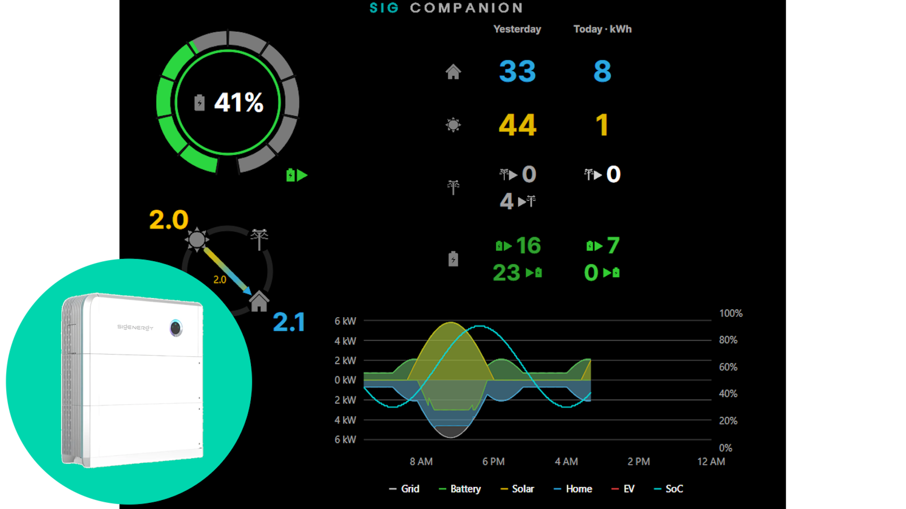

# Sig Companion

A .NET Avalonia application that allows you to monitor your Sigenergy battery and connected solar
using data from the cloud API and local Modbus interface.

Store installation links:
 - [Android (Google Play)](https://play.google.com/store/apps/details?id=com.thirtyhippos.sigcompanion)

Other information:
 - [FAQs](https://github.com/tomhollander/SigCompanion/wiki/FAQs)
 - [Privacy Policy](https://github.com/tomhollander/SigCompanion/wiki/Privacy-Policy)